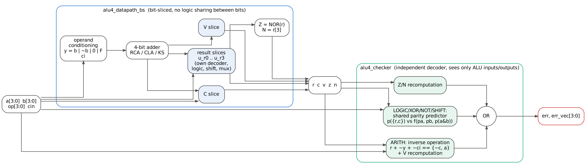
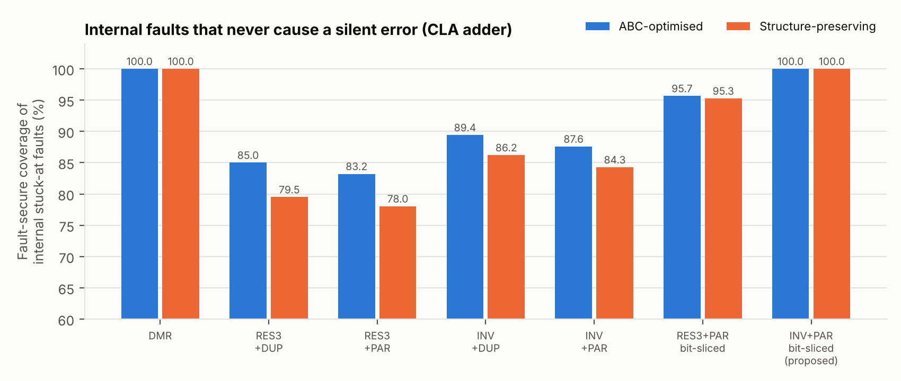

# Self-Checking 4-bit ALU in Verilog — design, verification and fault-injection study

A 4-bit, 16-operation ALU (ADD ADC SUB SBB INC DEC AND OR XOR NOR NOT SHL SHR ASR ROL ROR,
flags C V Z N) with three adder architectures (ripple-carry, carry-lookahead, Kogge-Stone) and a
configurable concurrent-error-detection checker. The proposed configuration — inverse-operation
check for arithmetic, parity prediction for everything else, on a bit-sliced sharing-free
datapath — is fault-secure for 100 % of internal single stuck-at faults, the same as
duplication-with-comparison, and also flags most design errors that duplication cannot.

The full write-up is `docs/Project_Report.docx` (PDF copy alongside).





## Tools used
| Tool | Version | Purpose |
|---|---|---|
| Icarus Verilog | 12.0 | RTL and gate-level simulation |
| Yosys + ABC | 0.33 | logic synthesis (54 netlists) |
| Verilator | 5.020 | `-Wall` lint |
| Python 3 + matplotlib | 3.13 / 3.11 | fault simulator, analysis, figures |
| Graphviz | — | block diagram, Yosys schematic |

## Reproduce everything
```
./run_all.sh          # ~2.5 min: lint, RTL sims, mutation test, synthesis,
                      # gate sims, fault campaign, cross-validation, figures
node docs/build_report.js   # rebuild the report from the result files
```

## Directory map
| Path | Content |
|---|---|
| `rtl/` | `adder4.v` (RCA/CLA/KS), `alu4_datapath.v`, `alu4_datapath_bs.v` (bit-sliced), `alu4_checker.v`, `alu4_sc_core.v`, `alu4_dmr_core.v`, `alu4_base_core.v`, `alu4_sc_top.v` (registered wrapper), `alu4_defs.vh` |
| `tb/` | `tb_alu4_exhaustive.v` (8192 vectors, RTL or gate level), `tb_alu4_fault_demo.v` (force/release fault demo), `tb_alu4_top.v` (clocked), `alu4_ref.vh` (reference model) |
| `scripts/` | `gatesim.py` (bit-parallel gate/fault simulator), `run_synth.py`, `fault_campaign.py`, `crossval_iverilog.py`, `mutation_test.py`, `make_figures.py` |
| `synth/out/<variant>/` | `synth.ys`, `yosys.log`, `stat.txt`, `netlist.v`, `netlist.json` for each of 54 variants |
| `sim/logs/` | every simulation / lint / mutation log; `sim/vectors/` full vector dumps; `sim/waves/` VCD (open with GTKWave) |
| `fault/` | `results/summary.csv`, per-fault CSV for each netlist, `crossval_report.txt`, `campaign_log.txt` |
| `docs/` | report (.docx, .pdf), `figures/`, `build_report.js` |

Variant names: `<design>_<adder>_<flow>` with design ∈ {base, base_bs, dmr, sc_res3dup, sc_res3par,
sc_invdup, sc_invpar, sc_res3par_bs, sc_invpar_bs}, adder ∈ {rca, cla, ks}, flow ∈ {struct, opt}.

## Key results (CLA adder, ABC-optimised netlists)
| Design | Gates | Depth | Internal fault-secure coverage |
|---|---|---|---|
| Base (no checking) | 137 | 16 | 0 % |
| DMR | 289 | 20 | 100 % |
| INV + PAR, conventional datapath | 276 | 27 | 87.6 % |
| RES3 + PAR, bit-sliced | 323 | 29 | 95.7 % |
| **INV + PAR, bit-sliced (proposed)** | **293** | **27** | **100 %** |

Verification: 21/21 RTL and 54/54 gate-level exhaustive simulations pass; 14/14 testbench
mutants killed; fault simulator matches Icarus Verilog on all 54 fault-free netlists and on 324
injected faults.
